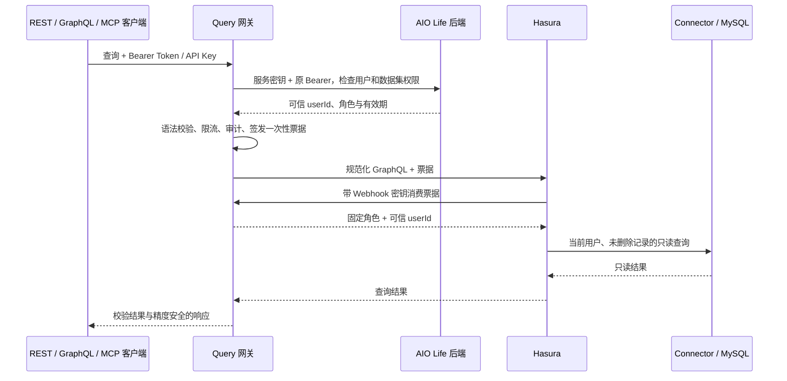

# AIO Life Query

AIO Life 的独立只读查询服务，使用 Java 21、Spring Boot 3.5.16、Hasura v3 和 MySQL Connector。提供 REST、GraphQL HTTP 与 MCP 入口，查询当前用户的时迹、运动、阅读、影视、视频和演出记录；支持明细、汇总及时迹分类关系，不接收原始 SQL，不提供写入或大模型调用。

本仓库与 [aio-life-server](https://github.com/lys1313013/aio-life-server) 独立维护。用户身份和业务权限由配套后端校验，业务数据由 Connector 使用只读账号读取。

| 文档 | 用途 |
| --- | --- |
| [Docker 与 GitHub Actions](docs/Docker与GitHubActions.md) | 镜像构建、发布、Secrets 与 Compose 部署 |
| [验证记录](docs/验证记录.md) | 测试入口、覆盖边界及按日期保存的历史结果 |
| [Connector 来源与修改范围](connector/UPSTREAM.md) | 固定上游、补丁、分类 SQL 与发布前待核实事项 |
| [Codex 本地验证](docs/Codex本地验证.md) | 历史客户端验收与重新验收方法 |

## 环境与启动

以下命令均在本仓库根目录执行。网关开发需要 JDK 21、Maven；元数据生成需要 Python 3；容器部署和隔离端到端验证需要 Docker Compose。Connector 构建使用 JDK 21 / Gradle 8.14.3，默认使用固定上游的 Gradle Wrapper。

完整查询链依赖可用的 AIO Life 后端、专用 Redis、Hasura 和 MySQL Connector。单独启动 Java 网关不会启动这些依赖，也不会初始化业务数据库。

### 运行环境变量

| 变量 | 默认值 / 配置要求 |
| --- | --- |
| `AIO_QUERY_PORT` | `45680`，网关端口 |
| `AIO_QUERY_MANAGEMENT_PORT` / `AIO_QUERY_MANAGEMENT_ADDRESS` | `45681` / `127.0.0.1`，管理端点仅开放 health、info |
| `AIO_QUERY_ACCESS_URL` | `http://127.0.0.1:45678/api/internal/query/access/check-token` |
| `AIO_QUERY_HASURA_URL` | `http://127.0.0.1:45682/graphql`；Compose 使用容器内地址 |
| `AIO_QUERY_SERVICE_KEY` | 必填，至少 32 字符，与后端 `AIO_LIFE_QUERY_ACCESS_SERVICE_KEY` 相同 |
| `AIO_QUERY_WEBHOOK_KEY` | 必填，至少 32 字符，供 Hasura 认证 Webhook 使用，与服务密钥分开设置 |
| `AIO_QUERY_REDIS_HOST` / `AIO_QUERY_REDIS_PORT` / `AIO_QUERY_REDIS_PASSWORD` | `127.0.0.1` / `6379` / 空；Compose 使用内部 Redis 且要求密码 |
| `AIO_QUERY_AUDIT_DIRECTORY` | 本机 `./artifacts/audit`；镜像 `/app/audit`，运行用户必须可写 |
| `AIO_QUERY_MCP_ALLOWED_ORIGINS` | 空；需要浏览器 MCP 接入时填写逗号分隔的精确可信 Origin |
| `AIO_QUERY_CONNECTOR_KEY` | 元数据生成和 Connector 部署必填，至少 32 字符，使用独立密钥 |
| `AIO_QUERY_CONNECTOR_URL` / `AIO_QUERY_AUTH_WEBHOOK_URL` | 元数据生成默认 `http://mysql-connector:8080` / `http://gateway:45680/internal/hasura/auth` |
| `AIO_QUERY_JDBC_URL` | Compose 必填，含只读账号的 JDBC URL，由 Connector 使用 |
| `AIO_QUERY_CONFIG_GID` | Compose 必填，容器读取生成元数据所需的附加组 ID |
| `AIO_QUERY_ENGINE_IMAGE` | Compose 必填，经过目标环境验证的引擎镜像，部署时使用不可变 digest |
| `AIO_QUERY_GATEWAY_IMAGE` / `AIO_QUERY_CONNECTOR_IMAGE` | Compose 默认 `aio-life-query:local` / `aio-life-query-mysql-connector:local` |

配置默认值见 [application.yml](src/main/resources/application.yml)，Compose 注入项见 [deploy/compose.yml](deploy/compose.yml)。本机直接运行 Maven 不自动加载 `.env`；通过终端或 IDE 注入环境变量。配置文件、JDBC 凭据、Token 和生成的密钥文件均不得提交。

### 本机运行网关

先在配套后端启用 `AIO_LIFE_QUERY_ACCESS_ENABLED=true` 并配置服务密钥；允许的应用 ID 默认为 `aio-life-query`。准备 Redis 和 Hasura，注入上表中的网关配置后执行：

```bash
mvn spring-boot:run
```

默认 API 为 `http://127.0.0.1:45680`，管理健康端点为 `http://127.0.0.1:45681/actuator/health`。网关没有业务后端的 `/api` context-path；健康检查成功也不等同于授权、Hasura 和数据库整条链路已经可用。

### 独立部署

1. 按 [readonly-account.sql.example](deploy/readonly-account.sql.example) 创建列级 SELECT 账号，核对目标库的字段、类型、记录归属和索引。网关不迁移业务表；所需结构变更由后端增量迁移维护。
2. 配置后端查询授权开关及服务密钥，注入网关、Webhook、Connector、Redis、只读 JDBC 和镜像变量。容器中的 `AIO_QUERY_ACCESS_URL` 必须能访问业务后端，不能直接套用宿主机的 `127.0.0.1` 地址。
3. 生成元数据，并在本地构建 Connector 后启动 Compose：

   ```bash
   export AIO_QUERY_CONFIG_GID="$(id -g)"
   python3 scripts/build_metadata.py
   bash scripts/build_connector.sh
   docker compose -f deploy/compose.yml up -d --build
   ```

   使用已准备的网关、Connector 发布镜像时，设置对应镜像变量，按[镜像部署说明](docs/Docker与GitHubActions.md)拉取后执行 `docker compose -f deploy/compose.yml up -d --no-build`。Hasura 镜像需另行准备，Compose 不自动构建引擎。
4. 通过 HTTPS 代理仅发布 `/api/v1/`、`/graphql` 和 `/mcp`。Compose 只将网关 `45680` 绑定到宿主回环地址，Hasura、Connector、Redis 不发布宿主端口；后端内部授权接口仅允许网关网络访问。跨主机内部通信和生产 MySQL 连接需配置 TLS。

元数据输出到 `.cache/hasura/`，包含内部密钥，目录权限为 `0750`、文件为 `0640`。附加组应只包含可信部署账号；生成器逐文件原子替换，失败后应完整重跑再重启服务。字段、关系、版本或密钥变化时，必须重新生成并部署相互匹配的网关、元数据和 Connector 配置。

审计按 UTC 日期写入 JSONL，记录身份、状态、版本、查询结构指纹与行数，不记录业务正文、变量、Token、票据或结果。目录权限为 `0700`、文件为 `0600`，存储需支持 POSIX 权限；运维负责保留期、采集与容量告警。

## 权限链路



- REST、GraphQL 和 MCP 的身份仅来自 `Authorization: Bearer ...`。用户使用现有登录 Token 或 API Key，不能通过参数、角色或 `X-Hasura-*` 请求头指定身份。
- 网关实时调用 `POST /api/internal/query/access/check-token`，不解析 JWT、不缓存认证结果、不共享后端 Redis。后端同时检查 `/mcp/tools` 及数据集对应业务的二级锁；无权限的数据集不出现在目录中，直接描述或执行也会拒绝。
- 执行票据存入专用 Redis，绑定用户、数据集和发布版本，有效期最多 30 秒且不超过原凭据有效期，原子消费一次。Webhook 和返回结果前不再远程鉴权；退出、撤销凭据或重新锁定阻止后续请求，已经获准的在途查询可以完成。
- 明细和汇总都受 `user_id = 当前用户 AND is_deleted = 0` 约束。查询中的 `userId`、`isDeleted` 只是与行权限取交集的筛选条件。MySQL 账号仅允许白名单列 SELECT，Connector 禁用 mutation、explain 和请求级连接地址覆盖。
- 没有结果缓存；依赖、结果校验或审计失败时拒绝返回成功，不返回 Hasura 部分数据。内部接口和基础设施不能作为公网查询入口。

## 对外接口

| 接口 | 用途与响应 |
| --- | --- |
| `GET /api/v1/datasets` | 发现当前用户可用数据集 |
| `GET /api/v1/datasets/{name}` | 读取 SDL、字段语义、版本、范围与限制 |
| `POST /api/v1/queries/validate` | 预检查询；执行时仍重新授权 |
| `POST /api/v1/queries/execute` | 同步执行明细或汇总 |
| `POST /graphql` | 受限 GraphQL HTTP，响应为 `data` / `errors` / `extensions` |
| `POST /mcp` | 无持久会话的 MCP Streamable HTTP |

REST 使用 `{ "rscode": "0", "result": null, "data": ... }`，与业务后端的数字 `code` 协议不同。失败同时使用 HTTP 状态与稳定错误码，如 `AUTH_REQUIRED`、`ACCESS_DENIED`、`SECONDARY_LOCK_REQUIRED`、`SCHEMA_CHANGED`、`QUERY_LIMIT_EXCEEDED`、`UPSTREAM_QUERY_FAILED`。不要仅根据 HTTP 200 判断业务或 MCP 工具执行成功。

以下请求要求调用环境安全注入 `AIO_LIFE_TOKEN`，可以是登录 Token 或 API Key；`AIO_QUERY_URL` 是网关地址：

```bash
export AIO_QUERY_URL=http://127.0.0.1:45680

curl "$AIO_QUERY_URL/api/v1/datasets/time_record" \
  -H "Authorization: Bearer $AIO_LIFE_TOKEN"

curl "$AIO_QUERY_URL/api/v1/queries/execute" \
  -H "Authorization: Bearer $AIO_LIFE_TOKEN" \
  -H 'Content-Type: application/json' \
  --data-binary @examples/time-record-query.json
```

[examples/](examples/) 中的日期是固定示例，调用前按需调整。REST / MCP 查询仅 `query` 必填，支持匿名或唯一具名 query；`variables` 按需提供。数据集与操作名由查询推导，可用详情中的 `releaseId` 填写 `expectedRelease` 防止跨版本执行；不匹配时重新读取该数据集详情。旧 `domain/schemaVersion/policyVersion/operationName` 入参不再接受。目录只含摘要，字段、SDL、枚举、限制与示例在单数据集详情中按需读取。

### GraphQL HTTP

请求 JSON 包含 `query`，可选 `operationName`、`variables`；`extensions` 仅接受空对象或 `null`。支持匿名或单个命名 query，数据集由根字段推导并使用当前版本；此入口不接受 `expectedRelease`：

```bash
curl "$AIO_QUERY_URL/graphql" \
  -H "Authorization: Bearer $AIO_LIFE_TOKEN" \
  -H 'Content-Type: application/json' \
  -H 'Accept: application/graphql-response+json' \
  --data-binary @examples/graphql-query.json
```

成功时 `data` 包含根字段结果，`extensions` 包含 `queryId`、数据集、版本、行数与执行时间。失败时使用 `errors[].extensions.code`，不返回部分数据。仅支持 POST JSON；SDL 通过带鉴权的数据集描述接口获取，不提供内省。

### MCP

当前使用 Java MCP SDK `0.14.0` 的无会话 WebMVC Streamable HTTP 传输，入口为 `https://<query-host>/mcp`。客户端需要支持自定义 Bearer 请求头；没有 OAuth 登录跳转或 GET 常驻 SSE。每个 HTTP 请求重新认证，初始化或 session id 不能代替身份。

| 工具 | 参数 / 用途 |
| --- | --- |
| `aio_query_list_datasets` | `{}`，发现可用数据集 |
| `aio_query_describe_dataset` | `{ "name": "time_record" }`，读取 SDL、releaseId、字段和限制 |
| `aio_query_validate` | 与 REST 查询请求相同，可选预检，普通查询可直接执行 |
| `aio_query_execute` | 与 REST 查询请求相同，执行 |

客户端配置示意，凭据由客户端安全注入，不写入提示词、工具参数或版本库：

```json
{
  "mcpServers": {
    "aio-life-query": {
      "url": "https://<query-host>/mcp",
      "headers": { "Authorization": "Bearer <AIO_LIFE_TOKEN_OR_API_KEY>" }
    }
  }
}
```

HTTP 工具请求见 [mcp-tools-call.json](examples/mcp-tools-call.json)，发送时设置 `Content-Type: application/json` 和 `Accept: application/json, text/event-stream`。当前服务允许直接调用 `tools/list` / `tools/call`，也支持 `initialize` 握手；初始化夹具使用协议 `2025-06-18`。

成功结果同时提供文本 `content` 和 `structuredContent`，后者使用 REST 信封；业务失败为 `isError=true`，认证失败返回 HTTP 401/403。默认拒绝带 Origin 的 MCP 请求；浏览器接入需设置精确 Origin 白名单，并由 HTTPS 代理处理 CORS 和预检，不配置 `*`。

## 当前数据集

完整字段、类型和语义以 [datasets.json](src/main/resources/datasets.json) 及描述接口返回的 SDL 为准，避免在客户端硬编码字段目录。

| 数据集 | domain | releaseId | 明细 / 汇总根字段 | 日期范围字段 |
| --- | --- | --- | --- | --- |
| `time_record` | `time` | `time-record-v3` | `timeRecords` / `timeRecordStats` | `date` |
| `exercise_record` | `exercise` | `exercise-record-v2` | `exerciseRecords` / `exerciseRecordStats` | `exerciseDate` |
| `read_record` | `reading` | `read-record-v2` | `readRecords` / `readRecordStats` | `createdAt`、`startTime`、`finishTime` |
| `movie` | `movie` | `movie-v2` | `movies` / `movieStats` | `createdAt`、`startTime`、`finishTime` |
| `b_video` | `video` | `b-video-v2` | `bVideos` / `bVideoStats` | `createdAt`、`lastWatched` |
| `performance` | `performance` | `performance-v2` | `performances` / `performanceStats` | `performanceDate` |

每次查询至少为一个范围字段提供 `_gte` / `_lt` 半开区间，最长 366 天。日期使用 `YYYY-MM-DD`；DATETIME 还接受无时区的 `YYYY-MM-DDTHH:mm:ss`，按数据库本地时间比较。按 `finishTime` 与按 `createdAt` 查询含义不同，范围条件不会自动应用到其他时间字段。

每个查询只允许一个操作、一个根字段。支持已发布字段的别名、变量、筛选和排序；不支持 fragment、directive、内省、mutation、subscription、批量请求、逻辑 OR、`groupBy`、模糊搜索或任意跨表查询。明细使用 `limit/offset` 分页，默认按第一个范围字段降序，未指定 ID 排序时追加 `id: Asc`。

| 限制 | 当前值 |
| --- | --- |
| 查询文档 / HTTP 请求 / 上游响应 | 32 KiB / 64 KiB / 1,000,000 字节 |
| 明细行数 / offset | 默认 100、最多 1,000 / 最大 10,000 |
| 排序项 | 最多 3 项，每项 1 个字段；关系字段不支持排序 |
| 并发 / 频率 | 每用户 2、全局 10 / 每用户每分钟 30 次 |
| 授权接口 / Hasura 超时 | 3 秒 / 10 秒，包含正文读取 |
| JDBC / MySQL 执行时限 | 5 秒 / `max_execution_time=5000` |

所有 ID、BIGINT、金额和汇总数值以字符串返回；其他字段以 SDL 和实际 JSON 为准，空集 `sum` 为 `null`，`pagesInfo` 是 JSON 对象/数组。时迹 `startTime/endTime` 为当天分钟数，阅读与影视同名字段为日期时间；视频时长为秒，时迹和演出时长为分钟，票价为元。运动 `count` 是记录条数，`exerciseCount` 应按运动类型分别统计。

没有取消接口，HTTP 停止等待不保证数据库立即停止，执行时间由 JDBC 和数据库时限约束。

### 按分类名称查询时迹

时迹明细可选取 `category { id name }`，明细和汇总都支持 `where.category.id/name._eq`。示例见 [sleep-before-midnight.json](examples/sleep-before-midnight.json)，发送到 `/graphql`。其中 `startTime = 0` 只说明片段从零点开始，不能据此推断实际入睡时间。

分类名称按当前用户覆盖后的有效名称匹配，同名分类均可匹配；公共分类保留公共 ID。停用分类保留历史元数据，删除、缺失或其他用户私有分类返回 `category: null`。关系来自 [relationships.json](src/main/resources/relationships.json) 和[固定派生 SQL](connector/time-record-category.sql)，无需创建数据库视图，没有独立公开根查询。

分类专项验证需要先构建 Connector 和网关 JAR，再运行 `python3 scripts/test_category_relationship.py`。如需覆盖 MySQL 5.7，可设置 `AIO_QUERY_CATEGORY_MYSQL_IMAGE=mysql@sha256:4bc6bc963e6d8443453676cae56536f4b8156d78bae03c0145cbe47c2aad73bb`，ARM 主机同时设置 `AIO_QUERY_CATEGORY_MYSQL_PLATFORM=linux/amd64`。此脚本使用本地授权桩，不能代替真实后端授权验收。

## 构建与本地验证

按改动范围选择检查；纯文档修改检查差异和引用即可。

当前 `scripts/test_e2e.sh` 的测试库初始化只执行后端全量基线，尚未纳入 `2026-10-28_02_unify_common_fields.sql`。配合当前后端运行前，需先将脚本初始化与[后端数据库说明](https://github.com/lys1313013/aio-life-server/blob/main/docs/数据库初始化与验证.md)对齐；历史端到端结果不能视为当前组合已通过。

```bash
# Java 检查；未配置测试 Redis 时跳过 Redis 集成测试
mvn test

# 元数据权限、生成与数据集策略检查
PYTHONDONTWRITEBYTECODE=1 python3 -m unittest discover -s tests -p 'test_*.py'

# 完整隔离授权链：先构建 Connector，脚本会打包网关并运行配套后端测试
bash scripts/build_connector.sh
bash scripts/test_e2e.sh
```

单独覆盖全部网关测试并打包时，准备 `127.0.0.1` 上的隔离无密码 Redis，执行 `AIO_QUERY_TEST_REDIS_PORT=<port> mvn -B -ntp verify -DfailIfNoTests=true`，不要指向业务 Redis。`AIO_QUERY_JAVA_HOME` / `JAVA_HOME` 可指定 JDK 21；`AIO_QUERY_GRADLE` 可指定 Gradle 8.14.3，不使用 Gradle 9。

完整端到端脚本需要相邻的 `aio-life-server`，可用 `AIO_LIFE_SOURCE` 指定路径。它创建临时 MySQL / Redis / Hasura，使用虚构数据和测试密钥，退出时清理自己的容器与 Connector 进程。默认占用 `45680/45682/45683`，可通过 `AIO_QUERY_TEST_GATEWAY_PORT`、`AIO_QUERY_TEST_HASURA_PORT`、`AIO_QUERY_TEST_CONNECTOR_PORT` 调整。报告位于两仓库的 `target/surefire-reports/`，日志位于 `.cache/e2e/` 和后端 `target/query-e2e/`。

[GitHub Actions](.github/workflows/docker-publish.yml) 对 PR 执行网关、Redis、Python 与镜像检查，通过后在 `main` / `v*` 发布网关镜像；不执行生产部署，也不代替 Hasura、Connector 和 MySQL 的完整链路验收。历史通过结果见[验证记录](docs/验证记录.md)，不能作为当前代码或目标环境的验证结果。

## 目录结构

```text
src/main/java/top/aiolife/query/  # API、鉴权、查询编译、执行、票据与审计
src/main/resources/             # 配置、数据集与关系白名单
src/test/                       # Java 测试
deploy/                         # Compose、镜像与只读账号示例
connector/                      # 固定上游说明、补丁与派生 SQL
scripts/                        # 元数据生成、构建与隔离验证
examples/                       # REST、GraphQL 与 MCP 请求示例
tests/                          # Python 策略测试与数据库夹具
docs/                           # 部署与历史验证记录
```

修改数据集或关系时，同步发布版本、示例、列级授权和元数据；用户每次查询只需提交请求，无需修改这些服务端配置。

### 固定的上游来源

构建脚本固定 Hasura Engine commit 和 MySQL NDC 归档及校验值，Connector 补丁仅保留 MySQL 并使用 jOOQ OSS。来源、补丁范围和许可核验记录统一见 [connector/UPSTREAM.md](connector/UPSTREAM.md)。既有记录中的 Connector 生产使用与再分发授权仍有待落实，不将本地验证视为完成发布条件。

隔离测试使用固定 digest 的 `ddn-engine-local-dev` 镜像。[build_engine.sh](scripts/build_engine.sh) 提供源码引擎构建入口；目标生产引擎、实际数据库结构、只读副本延迟、容量与发布网络需要单独验证。当前没有授权管理 UI、长期应用授权或自动密钥轮换。
