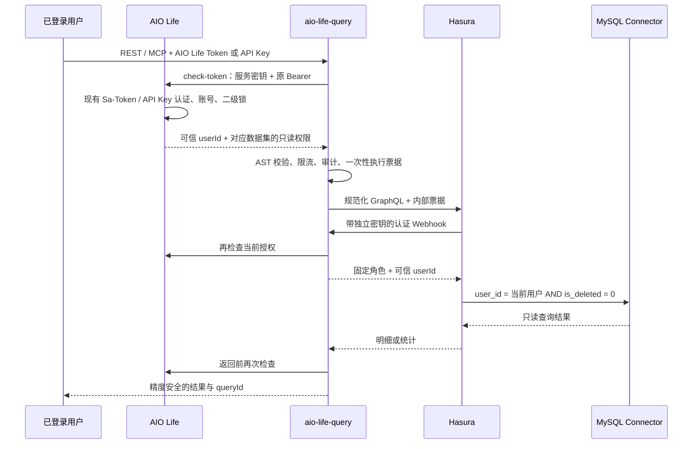

# AIO Life Query — 生活数据只读查询

独立 Java 21 / Spring Boot 服务。AI 先读取授权目录，再提交受限 GraphQL；Hasura v3 将查询转换到 MySQL。目前发布时迹、运动、阅读、影视、视频和演出六个数据集，提供 REST 和 MCP 入口；不提供原始 SQL、写入、关联表或大模型调用。

这是独立本地 Git 仓库，尚未创建远程仓库。配套授权接口位于相邻 `aio-life-server` 仓库的 `top.aiolife.sso.query`。

工程、服务、Docker 镜像、MCP serverInfo 与授权应用 ID 统一为 `aio-life-query`。现有 `AIO_QUERY_*` 环境变量、`X-AIO-Query-Service-Key` / `X-AIO-Webhook-Key` 请求头、`aio_query_*` MCP 工具名及 Redis Key 保持兼容。若显式设置过 `AIO_LIFE_QUERY_ACCESS_ALLOWED_APPS`，将其中的查询应用名更新为 `aio-life-query`；默认配置已同步。

2026-10-05 已完成直接 Token 校验与 MCP 接入；验证结果、环境、范围与生产发布限制见 [验证记录](docs/验证记录.md)。

同日使用 Codex CLI 0.160.0 完成本地真实客户端验收：修复扩展能力字段导致的初始化失败，A/B 客户端共 19 次工具调用验证目录、预检、明细、汇总、分页、精度及隔离，另有 30 项相关回归测试通过。详见 [Codex 本地验证](docs/Codex本地验证.md)。

## 权限链路



- 用户使用现有 AIO Life 登录 Token 或 API Key；REST 和 MCP 均从 `Authorization: Bearer ...` 读取，不能从工具参数指定身份或角色。公网入口拒绝 `X-Hasura-*`。
- 每次请求直接调用 AIO Life 的内部 `check-token`，网关不解析 JWT、不共享 AIO Life Redis、不缓存认证结果。授权客户端兼容后端旧版字符串 `rscode` 和新版数字 `code`，同时出现且不一致时拒绝。接口经过原有 Sa-Token / API Key 拦截器，并且必须提供独立服务密钥；固定应用 `aio-life-query`，按数据集返回固定角色和读取范围（时迹仍为 `ai_time_reader` / `time.read`）。目录发现使用 `ai_query_catalog` / `query.catalog`，不授予 Hasura 数据读取权限。没有新增逐应用用户授权记录；当前查询能力由功能开关、有效凭据和二级锁共同控制。
- AIO Life 检查 `/mcp/tools` 和对应业务菜单的二级锁；时迹仍检查 `/time/time-tracker`、`/time/dashboard`，其他数据集分别检查 `/record/exercise`、`/record/read`、`/record/movie`、`/record/videoWatch`、`/record/performance`。锁定的数据集不出现在目录中，直接描述或执行同样拒绝；会话退出、账号删除、API Key 删除/过期和重新锁定均影响后续执行。默认关闭整个查询授权功能。
- 明细与聚合共用 Hasura 行权限，均剔除其他用户和逻辑删除记录。`userId` / `isDeleted` 不出现在对外目录，网关也不接受它们作为输入。
- MySQL 账号只授予六个数据集白名单列的 SELECT（见 `deploy/readonly-account.sql.example`）；时迹标题/描述、视频笔记、演出座位/订单号等未发布字段在数据库权限层也不可读。Connector 禁用 mutation、explain、请求级连接地址覆盖，保留单一配置数据源。
- Redis 票据绑定数据集及其版本，仅保留最多 30 秒、原子消费一次；Webhook 复核相同业务并只返回该数据集角色，不能用运动票据访问其他表。票据中保存原始 AIO Life Token / API Key，供 Webhook 实时复核，必须使用专用私有 Redis；不要向客户端开放 Redis 或 Hasura/Connector 端口。
- 没有结果缓存；依赖或审计失败不返回成功，不返回 Hasura 的部分数据。单次调用使用固定发布版本，返回前再检查。

## 对外接口

| 服务 | 接口 | 作用 |
|---|---|---|
| AIO Life（内部） | `POST /api/internal/query/access/check-token` | 现有 Token / API Key 实时检查 |
| aio-life-query | `POST /mcp` | MCP Streamable HTTP，无持久会话 |
| aio-life-query | `GET /api/v1/datasets` | 读取当前可用目录 |
| aio-life-query | `GET /api/v1/datasets/{name}` | SDL、字段语义和限制 |
| aio-life-query | `POST /api/v1/queries/validate` | 校验查询，不能代替执行时授权 |
| aio-life-query | `POST /api/v1/queries/execute` | 同步执行 |

响应沿用 `{rscode:"0",result:null,data:...}`。失败使用 HTTP 状态及稳定错误码，如 `ACCESS_DENIED`、`SECONDARY_LOCK_REQUIRED`、`SCHEMA_CHANGED`、`QUERY_UNSUPPORTED`、`QUERY_LIMIT_EXCEEDED`、`UPSTREAM_QUERY_FAILED`。

内部接口：AIO Life `/api/internal/query/access/check-token` 同时需要原用户 Bearer 和 `X-AIO-Query-Service-Key`；网关 `/internal/hasura/auth` 需要另一把 `X-AIO-Webhook-Key`。反向代理只发布 `/api/v1/` 和 `/mcp`，AIO Life 的内部接口仅允许网关网络访问。

## AI 调用示例

可信客户端把 AIO Life 登录 Token 或 API Key 配置在请求头。凭据交给 MCP 客户端的传输层；不要放进提示词、工具参数、版本库或日志。

```bash
curl "$AIO_QUERY_URL/api/v1/datasets/time_record" \
  -H "Authorization: Bearer $AIO_LIFE_TOKEN"

curl "$AIO_QUERY_URL/api/v1/queries/execute" \
  -H "Authorization: Bearer $AIO_LIFE_TOKEN" \
  -H 'Content-Type: application/json' --data-binary @examples/time-record-query.json
```

### MCP

使用官方 Java SDK `0.14.0` 的无会话 WebMVC Streamable HTTP 传输，与现有 AIO Life SDK 版本一致。入口为 `https://<query-host>/mcp`；经验证的初始化协议为 `2025-06-18`。服务端允许直接调用 `tools/list` / `tools/call`，无需先调用 `initialize`；保留初始化接口兼容旧客户端。这不代表已升级到 MCP `2026-07-28`。GET 不提供 SSE 常驻连接，HTTP POST 返回 JSON-RPC，通知返回 202。无 OAuth 登录跳转；客户端必须支持自定义 Bearer 请求头。每个 HTTP 请求（包括 initialize、tools/list）重新认证，不把 session id 当成身份。

| 工具 | 参数 / 用途 |
|---|---|
| `aio_query_list_datasets` | `{}`，发现已发布数据集 |
| `aio_query_describe_dataset` | `{"name":"time_record"}`（或下表其他数据集名），读取 SDL、字段语义及版本 |
| `aio_query_validate` | 与 REST 查询请求相同，预检受限 GraphQL |
| `aio_query_execute` | 与 REST 查询请求相同，执行当前用户的明细或汇总 |

客户端配置形态（按所用客户端的远程 MCP 配置格式填写，下面为示意；占位值需由客户端安全注入）：

```json
{
  "mcpServers": {
    "aio-life-query": {
      "url": "https://<query-host>/mcp",
      "headers": {"Authorization": "Bearer <AIO_LIFE_TOKEN_OR_API_KEY>"}
    }
  }
}
```

实际 HTTP 调用示例：

```bash
curl "$AIO_QUERY_URL/mcp" \
  -H "Authorization: Bearer $AIO_LIFE_TOKEN" \
  -H 'Accept: application/json, text/event-stream' \
  -H 'Content-Type: application/json' \
  -d '{"jsonrpc":"2.0","id":1,"method":"initialize","params":{"protocolVersion":"2025-06-18","capabilities":{},"clientInfo":{"name":"aio-client","version":"1"}}}'

curl "$AIO_QUERY_URL/mcp" \
  -H "Authorization: Bearer $AIO_LIFE_TOKEN" \
  -H 'Accept: application/json, text/event-stream' \
  -H 'Content-Type: application/json' --data-binary @examples/mcp-tools-call.json
```

成功结果同时提供 JSON 文本 `content` 和 `structuredContent`，其中 `structuredContent` 沿用 REST 响应格式。业务拒绝返回 `isError=true` 和稳定错误码；认证失败使用 HTTP 401/403，客户端不能自动改用匿名请求。默认拒绝所有带 Origin 的浏览器请求；确需接入浏览器时，通过 `AIO_QUERY_MCP_ALLOWED_ORIGINS` 配置逗号分隔的精确可信 Origin，不能填 `*`；浏览器跨域接入还需由 HTTPS 代理处理 CORS 及预检请求，服务本身没有开放通配跨域。

旧的签发/撤销及 `/api/internal/query/access/evaluate` 接口保留；当前网关默认仅使用直接校验接口，旧 `aqt_` 凭据不能用于此网关入口。

## 已发布数据集

`domain`、`schemaVersion`、`policyVersion` 必须与目录匹配；版本不一致返回 `SCHEMA_CHANGED`。五个新数据集沿用相同 MCP 工具，不增加按业务命名的工具。

| 数据集 | domain | schemaVersion / policyVersion | 明细 / 汇总根字段 | 可用于限定日期范围的字段 |
|---|---|---|---|---|
| `time_record` | `time` | `time-record-v1` | `timeRecords` / `timeRecordStats` | `date` |
| `exercise_record` | `exercise` | `exercise-record-v1` | `exerciseRecords` / `exerciseRecordStats` | `exerciseDate` |
| `read_record` | `reading` | `read-record-v1` | `readRecords` / `readRecordStats` | `createdAt`、`startTime`、`finishTime` |
| `movie` | `movie` | `movie-v1` | `movies` / `movieStats` | `createdAt`、`startTime`、`finishTime` |
| `b_video` | `video` | `b-video-v1` | `bVideos` / `bVideoStats` | `createdAt`、`lastWatched` |
| `performance` | `performance` | `performance-v1` | `performances` / `performanceStats` | `performanceDate` |

至少一个范围字段必须提供 `_gte` / `_lt` 半开区间，最大 93 天；日期接受 `YYYY-MM-DD`，DATETIME 字段也接受无时区的 `YYYY-MM-DDTHH:mm:ss`（按数据库本地时间比较）。范围筛选不会自动限制其他时间字段；按 `finishTime` 查询可找到以前创建、近期完成的阅读/影视记录，按 `createdAt` 可包含尚未开始的收藏。目录返回 `rangeFields` 和该数据集完整 SDL。

| 数据集 | 公开字段（除 id） | 汇总 |
|---|---|---|
| 时迹 | `date`、`categoryId`、`durationMinutes` | `count`、`durationMinutes { sum }` |
| 运动 | `exerciseDate`、`exerciseTypeId`、`exerciseCount` | `count`、`exerciseCount { sum }` |
| 阅读 | `title`、`type`、`author`、`url`、`status`、`totalProgress`、`currentProgress`、`startTime`、`finishTime`、`createdAt` | `count` |
| 影视 | `title`、`type`、`director`、`url`、`status`、`totalProgress`、`currentProgress`、`startTime`、`finishTime`、`rating`、`createdAt` | `count` |
| 视频 | `title`、`url`、`bvid`、`ownerName`、`durationSeconds`、`watchedDurationSeconds`、`episodes`、`currentEpisode`、`status`、`lastWatched`、`createdAt` | `count`、`durationSeconds { sum }`、`watchedDurationSeconds { sum }` |
| 演出 | `performanceName`、`performer`、`performanceType`、`performanceDate`、`city`、`venue`、`ticketPrice`、`durationMinutes`、`rating` | `count`、`ticketPrice { sum }`、`durationMinutes { sum }` |

运动 `count` 表示记录条数，不代表运动天数；`exerciseCount` 为对应运动类型的数量，不同类型应分别筛选分析。按日/周/月改变范围可分析趋势，当前不提供服务端 `groupBy`。视频时长单位为秒，时迹/演出时长为分钟，演出票价为元。所有 ID、`ticketPrice`、汇总数值返回十进制字符串（时迹的字符串记录 ID 原样保留）；空集 `sum` 为 null。

查询文档只允许一个具名 query、一个根字段；支持别名、变量、已发布筛选和排序。ID/文本支持 `_eq`；整数和金额支持 `_eq` / `_gte` / `_lte`，金额筛选值使用精确十进制字符串；状态为 `not_started` / `in_progress` / `completed` / `on_hold`。拒绝片段、指令、内省、关系、逻辑 OR、mutation 和 subscription。

调用示例位于 `examples/`：`exercise-record-stats.json`、`read-record-query.json`、`movie-query.json`、`b-video-query.json`、`performance-stats.json`。REST 直接提交示例；MCP 将同一 JSON 放入 `tools/call.params.arguments`，工具名为 `aio_query_validate` 或 `aio_query_execute`。

| 项目 | 首期固定限制 |
|---|---|
| 文档 / HTTP 请求 / 上游响应 | 32 KiB / 64 KiB / 1,000,000 字节 |
| 行数 / offset | 默认 100，最大 1,000 / 最大 10,000 |
| 并发 / 频率 | 每用户 2，全局 10 / 每用户 30 次每分钟 |
| 授权接口 / Hasura 超时 | 2 秒 / 10 秒，含读取正文 |
| JDBC / MySQL 执行时限 | 5 秒 / `max_execution_time=5000` |

未提供取消接口；HTTP 停止等待不等于数据库立刻停止，数据库与 JDBC 时限负责限制执行时间。审计按 UTC 日期写 JSONL 持久卷，仅记录身份、状态、版本、查询结构指纹和行数；不记录业务正文、变量、票据或结果。首期不自动清理审计，由运维配置保留期、采集和容量告警。

只有通过认证和用户限流的执行请求才进入持久审计，认证失败和限流拒绝不触发同步落盘。审计目录权限为 `0700`、文件为 `0600`，追加旧文件前也会收紧权限；拒绝符号链接目录和文件。审计卷须支持 POSIX 权限且允许运行 UID 设置权限，否则拒绝执行查询。

## 构建与本地验证

需要 JDK 21、Maven、Python 3、Docker。连接器第一次构建需要下载 Gradle/Kotlin/Quarkus 依赖。

```bash
mvn test
PYTHONDONTWRITEBYTECODE=1 python3 -m unittest discover -s tests -p 'test_*.py'
bash scripts/build_connector.sh
bash scripts/test_e2e.sh
```

`AIO_QUERY_GRADLE` 可指向已安装的 Gradle 8.14.3；不要使用 Gradle 9。`AIO_QUERY_JAVA_HOME` 或 `JAVA_HOME` 指向 JDK 21，构建脚本会覆盖 Gradle 全局的 JDK 选择。

端到端脚本只创建新的临时 MySQL / Redis 容器，导入配套服务的建表脚本，使用虚构数据和固定测试密钥。需要本机 45680、45682、45683 空闲；退出时删除自己创建的容器和连接器进程，不操作其他环境。`AIO_LIFE_SOURCE` 可指定配套后端路径。结果见两个项目的 `target/surefire-reports`，集成日志见 `.cache/e2e` 和后端 `target/query-e2e`。

测试内容包括 A/B 明细及统计隔离、逻辑删除、相邻大整数用户 ID、分类 ID 精度、原 Token 不能直连 Hasura、API Key 撤销/锁定/会话失效、真实 MCP 工具调用与跨用户隔离、只读列权限、票据重放、并发与输入绕过。脚本使用固定摘要的 Hasura **local-dev** 镜像，仅用于开发验证。

## Docker 与 GitHub Actions

沿用 `aio-life-server` 的测试后打包流程：PR 验证，`main` / `v*` 发布；JDK 21 与真实 Redis 测试通过后，同一份 JAR 经 `Dockerfile.runtime` 构建 `linux/amd64` 和 `linux/arm64` 网关镜像。默认推送 GHCR，配置四项 `ALIYUN_ACR_*` Secrets 后同时推送阿里云 ACR。发布前检查容器启动和认证边界；工作流不执行生产部署。

本地从源码执行 `docker build -t aio-life-query:local .`；Compose 可通过 `AIO_QUERY_GATEWAY_IMAGE` 使用发布的标签或 digest。构建上下文不包含环境文件、审计和元数据缓存。完整流程、Secrets、标签与部署命令见 [Docker 与 GitHub Actions](docs/Docker与GitHubActions.md)。

## 独立部署

1. 在目标数据库按 `deploy/readonly-account.sql.example` 创建运行账号。核对六个数据集白名单字段及数据类型，演出必须已完成 `performance.user_id` 的结构与归属回填；检查 `(user_id,is_deleted,date,id)` 查询计划并按现有迁移流程补索引。不要让查询服务自动迁移业务表。
2. AIO Life 配置 `AIO_LIFE_QUERY_ACCESS_ENABLED=true`、随机 `AIO_LIFE_QUERY_ACCESS_SERVICE_KEY`（至少 32 字符）；`AIO_LIFE_QUERY_ACCESS_ALLOWED_APPS` 默认 `aio-life-query`。直接模式复用原身份体系，无需新增业务表或签发第二个 Token。
3. 网关设置相同 `AIO_QUERY_SERVICE_KEY`、另一把随机 `AIO_QUERY_WEBHOOK_KEY`、独立 `AIO_QUERY_CONNECTOR_KEY`、`AIO_QUERY_ACCESS_URL`、`AIO_QUERY_REDIS_PASSWORD`。三把服务密钥均至少 32 字符。`AIO_QUERY_JDBC_URL` 使用只读账号，生产配置 MySQL TLS；凭据由部署平台注入，不提交 `.env`。
4. `export AIO_QUERY_CONFIG_GID="$(id -g)"`，执行 `python3 scripts/build_metadata.py`，生成权限固定的本地 OpenDD / AuthConfig / Connector 配置。输出含 Webhook 和 Connector 密钥，目录权限 `0750`、文件 `0640`；密钥先写入 `0600` 临时文件，完整写入后原子替换，失败时保留该文件的原版本并清理临时文件。运行容器通过附加组读取，该组只应包含可信部署账号；拒绝符号链接输出目录。不要导入全库表结构。
5. 准备连接器及经验证的引擎镜像，设置 `AIO_QUERY_ENGINE_IMAGE` 为不可变镜像摘要。本地构建使用 `docker compose -f deploy/compose.yml up -d --build`；使用发布镜像时设置 `AIO_QUERY_GATEWAY_IMAGE` / `AIO_QUERY_CONNECTOR_IMAGE` 并执行 `docker compose -f deploy/compose.yml up -d --no-build`，具体拉取步骤见上面的镜像文档。仅网关的 45680 绑定宿主回环地址，由现有 HTTPS 代理转发 `/api/v1/` 和 `/mcp`；其余服务不发布端口。跨主机内部流量需配置 TLS。

`scripts/build_engine.sh` 提供 Apache-2.0 源码引擎的固定 commit 构建入口，生产镜像需要单独运行相同端到端测试后发布。公开 `v3-engine` 镜像实际入口为 `ddn-engine-local-dev`，不能把开发验证直接当作生产镜像验收。源码构建、实际生产数据库结构、只读副本延迟、容量压测和发布网络均须在部署环境验证。

### 固定的上游来源

- [Hasura GraphQL Engine](https://github.com/hasura/graphql-engine/tree/45729d9437d93a2b54fc592a10e29e8267d4dfa7/v3)：源码引擎固定 commit。
- [Hasura MySQL NDC](https://github.com/hasura/ndc-jvm-mono/tree/7ea80f966e7abfeaba56957291ff555649e21809)：固定归档 SHA-256，补丁见 `connector/mysql-readonly.patch`。
- 原 MySQL Connector 引用了 `org.jooq.pro`。此处仅构建 MySQL，改用 `org.jooq:jooq:3.19.8` / `SQLDialect.MYSQL`，并移除其他商业数据库模块；[jOOQ 官方版本说明](https://www.jooq.org/download/)列出 OSS 的 MySQL 支持。维护此补丁及上游许可文件，不能把原始上游构建误认为无商业依赖。

选定 Connector 的归档未提供许可证，GitHub API 的 license 为 null；其生产使用与再分发授权尚未核实。更换 jOOQ 依赖不能解决整个仓库的许可问题，具体证据和发布边界见 [connector/UPSTREAM.md](connector/UPSTREAM.md)。

本期尚未提供授权管理 UI、长期应用授权、自动轮换、多表关系和可观测性平台接入；这些不影响 REST 单数据集调用，但属于后续需求。
