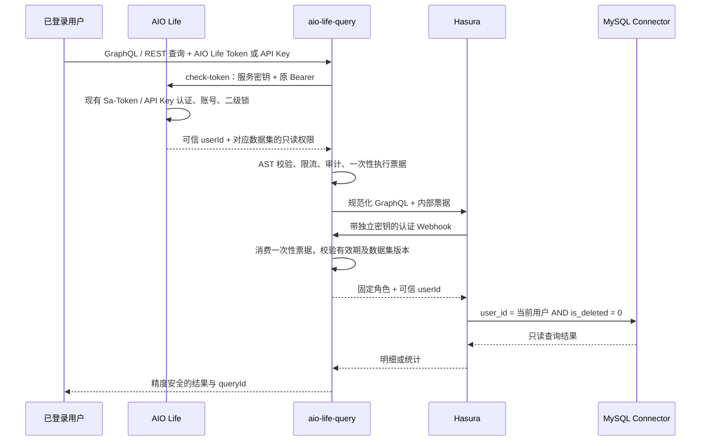

# AIO Life Query — 生活数据只读查询

文档核对日期：2026-10-18。当前接口与配置以本仓库源码为准；历史测试结果不代表当前环境已启动或生产已发布。

独立 Java 21 / Spring Boot 服务。AI 先读取授权目录，再提交受限 GraphQL；Hasura v3 将查询转换到 MySQL。目前发布时迹、运动、阅读、影视、视频和演出六个数据集，提供 REST、GraphQL HTTP 和 MCP 入口，支持时迹的分类关系；不提供原始 SQL、写入或大模型调用。

这是独立 Git 仓库，远程为 [lys1313013/aio-life-query](https://github.com/lys1313013/aio-life-query)。配套授权接口位于相邻 `aio-life-server` 仓库的 `top.aiolife.sso.query`。

工程、服务、Docker 镜像、MCP serverInfo 与授权应用 ID 统一为 `aio-life-query`。现有 `AIO_QUERY_*` 环境变量、`X-AIO-Query-Service-Key` / `X-AIO-Webhook-Key` 请求头、`aio_query_*` MCP 工具名及 Redis Key 保持兼容。若显式设置过 `AIO_LIFE_QUERY_ACCESS_ALLOWED_APPS`，将其中的查询应用名更新为 `aio-life-query`；默认配置已同步。

文档入口：

- [验证记录](docs/验证记录.md)：当前验证入口、覆盖边界与历史验收结果。
- [Codex 本地验证](docs/Codex本地验证.md)：2026-10-05 的真实客户端验收及与当前能力的差异。
- [Docker 与 GitHub Actions](docs/Docker与GitHubActions.md)：构建、发布、Secrets 和 Compose 部署。
- [Connector 来源与修改范围](connector/UPSTREAM.md)：固定源码、补丁、分类关系和授权核验边界。

## 权限链路



- 用户使用现有 AIO Life 登录 Token 或 API Key；REST、GraphQL HTTP 和 MCP 均从 `Authorization: Bearer ...` 读取，不能从工具参数指定身份或角色。公网入口拒绝 `X-Hasura-*`。
- 每次请求直接调用 AIO Life 的内部 `check-token`，网关不解析 JWT、不共享 AIO Life Redis、不缓存认证结果。授权客户端仅接收后端当前数字 `code`，拒绝旧 `rscode` 信封。接口经过原有 Sa-Token / API Key 拦截器，并且必须提供独立服务密钥；固定应用 `aio-life-query`，按数据集返回固定角色和读取范围（时迹仍为 `ai_time_reader` / `time.read`）。目录发现使用 `ai_query_catalog` / `query.catalog`，不授予 Hasura 数据读取权限。没有新增逐应用用户授权记录；当前查询能力由功能开关、有效凭据和二级锁共同控制。
- AIO Life 检查 `/mcp/tools` 和对应业务菜单的二级锁；时迹仍检查 `/time/time-tracker`、`/time/dashboard`，其他数据集分别检查 `/record/exercise`、`/record/read`、`/record/movie`、`/record/videoWatch`、`/record/performance`。锁定的数据集不出现在目录中，直接描述或执行同样拒绝；会话退出、账号删除、API Key 删除/过期和重新锁定均影响后续执行。默认关闭整个查询授权功能。
- 明细与聚合共用 Hasura 行权限，均剔除其他用户和逻辑删除记录。`userId` / `isDeleted` 也可读取和筛选，但用户条件与服务端行权限取交集，不能切换用户或读取已删除记录。
- MySQL 账号只授予六张已发布业务表各列和分类关系所需五列的 SELECT（见 `deploy/readonly-account.sql.example`），不开放账号、密码、Token 等其他表。六张表的所有物理字段均开放，包括标题、描述、笔记、座位、订单号以及审计字段。Connector 禁用 mutation、explain、请求级连接地址覆盖，保留单一配置数据源。
- Redis 票据保存入口校验后的身份及权限快照，绑定数据集和发布版本，有效期不超过 30 秒及原凭据剩余有效期，原子消费一次；Webhook 只校验票据并返回对应数据集角色和用户 ID，不再次调用 AIO Life。票据不保存原始 Token / API Key。使用专用私有 Redis，不向客户端开放 Redis 或 Hasura/Connector 端口。执行票据使用 v2 键空间，旧版在途票据在升级后会失败，客户端需重新提交查询。
- GraphQL / REST 单数据集查询仅在入口做一次完整用户和数据集鉴权，返回前不再远程复核。撤销凭据、删除账号或重新锁定业务会阻止下一次请求，已经获准且持有效执行票据的查询可以完成。没有结果缓存，依赖或审计失败不返回成功，不返回 Hasura 部分数据。目录发现仍按数据集检查可见性；MCP 传输层保留独立的目录认证。

## 对外接口

| 服务 | 接口 | 作用 |
|---|---|---|
| AIO Life（内部） | `POST /api/internal/query/access/check-token` | 现有 Token / API Key 实时检查 |
| aio-life-query | `POST /mcp` | MCP Streamable HTTP，无持久会话 |
| aio-life-query | `POST /graphql` | 带用户权限的受限只读 GraphQL，返回 `data` / `errors` / `extensions` |
| aio-life-query | `GET /api/v1/datasets` | 读取当前可用目录 |
| aio-life-query | `GET /api/v1/datasets/{name}` | SDL、字段语义和限制 |
| aio-life-query | `POST /api/v1/queries/validate` | 校验查询，不能代替执行时授权 |
| aio-life-query | `POST /api/v1/queries/execute` | 同步执行 |

REST 响应沿用 `{rscode:"0",result:null,data:...}`。失败使用 HTTP 状态及稳定错误码，如 `ACCESS_DENIED`、`SECONDARY_LOCK_REQUIRED`、`SCHEMA_CHANGED`、`QUERY_UNSUPPORTED`、`QUERY_LIMIT_EXCEEDED`、`UPSTREAM_QUERY_FAILED`。

内部接口：AIO Life `/api/internal/query/access/check-token` 同时需要原用户 Bearer 和 `X-AIO-Query-Service-Key`；网关 `/internal/hasura/auth` 需要另一把 `X-AIO-Webhook-Key`。反向代理只发布 `/api/v1/`、`/graphql` 和 `/mcp`，AIO Life 的内部接口仅允许网关网络访问。

下文命令在本仓库根目录执行；`AIO_QUERY_URL` 为网关地址（本地默认 `http://127.0.0.1:45680`），`AIO_LIFE_TOKEN` 由调用环境注入。示例文件使用固定日期，不自动切换为最近一个月；应按需修改区间。

### GraphQL HTTP

`POST /graphql` 使用 `Authorization: Bearer <AIO_LIFE_TOKEN_OR_API_KEY>`。先在大小和深度限制内解析根字段以确定数据集，再执行一次用户身份及该数据集权限校验和限流，复用数据集二级锁、一次性 Hasura 票据、用户行权限、逻辑删除过滤及审计。请求身份只取自 Bearer 凭据。查询中的 `userId` 是普通筛选条件；客户端不能通过它、角色或 `X-Hasura-*` 请求头覆盖身份。

请求体支持 `query`、可选 `operationName`、可选 `variables`。`extensions` 仅接受空对象或 `null`，暂不支持持久化查询等扩展。支持匿名查询或单个命名查询；省略 `operationName` 时使用文档中的唯一操作名。数据集和当前发布版本由服务端确定，不需要 REST 的 `domain`、`schemaVersion`、`policyVersion` 参数。需要固定版本校验的客户端继续使用 REST / MCP。

```bash
curl "$AIO_QUERY_URL/graphql" \
  -H "Authorization: Bearer $AIO_LIFE_TOKEN" \
  -H 'Content-Type: application/json' \
  -H 'Accept: application/graphql-response+json' \
  --data-binary @examples/graphql-query.json
```

成功响应的 `data` 直接包含根字段结果，`extensions` 包含查询 ID、数据集、发布版本、行数和执行时间等元数据：

```json
{"data":{"timeRecords":[]},"extensions":{"queryId":"...","dataset":"time_record","rowCount":0,"releaseId":"time-record-v3","schemaVersion":"time-record-v3","policyVersion":"time-record-v3","executedAt":"...","dataFreshness":{"mode":"configured-source","replicaLagMs":null}}}
```

失败响应示例：`{"errors":[{"message":"查询授权不可用","extensions":{"code":"ACCESS_DENIED"}}]}`。认证失败返回 401，权限不足或二级锁未解锁返回 403，查询不支持返回 400，限流返回 429；错误时不返回部分数据。支持响应类型 `application/graphql-response+json` 和 `application/json`。

这是沿用现有安全限制的 GraphQL 查询子集：单文档只允许一个操作、一个根字段；支持字段别名、变量、明细及聚合。禁止 mutation、subscription、fragment、directive、内省、批量请求及跨数据集查询；日期范围和行数上限与 REST 一致。只支持 POST JSON，不提供 GET 查询。SDL 和字段说明通过带鉴权的 `GET /api/v1/datasets/{name}` 获取。

## AI 调用示例

可信客户端把 AIO Life 登录 Token 或 API Key 配置在请求头。凭据交给 MCP 客户端的传输层；不要放进提示词、工具参数、版本库或日志。

```bash
curl "$AIO_QUERY_URL/api/v1/datasets/time_record" \
  -H "Authorization: Bearer $AIO_LIFE_TOKEN"

curl "$AIO_QUERY_URL/api/v1/queries/execute" \
  -H "Authorization: Bearer $AIO_LIFE_TOKEN" \
  -H 'Content-Type: application/json' --data-binary @examples/time-record-query.json
```

### MCP

使用官方 Java SDK `0.14.0` 的无会话 WebMVC Streamable HTTP 传输，与现有 AIO Life SDK 版本一致。入口为 `https://<query-host>/mcp`；经验证的初始化协议为 `2025-06-18`。服务端允许直接调用 `tools/list` / `tools/call`，无需先调用 `initialize`；按 MCP 协议提供 initialize 握手接口。这不代表已升级到 MCP `2026-07-28`。GET 不提供 SSE 常驻连接，HTTP POST 返回 JSON-RPC，通知返回 202。无 OAuth 登录跳转；客户端必须支持自定义 Bearer 请求头。每个 HTTP 请求（包括 initialize、tools/list）重新认证，不把 session id 当成身份。

| 工具 | 参数 / 用途 |
|---|---|
| `aio_query_list_datasets` | `{}`，发现已发布数据集 |
| `aio_query_describe_dataset` | `{"name":"time_record"}`（或下表其他数据集名），读取 SDL、字段语义及版本 |
| `aio_query_validate` | 与 REST 查询请求相同，预检受限 GraphQL |
| `aio_query_execute` | 与 REST 查询请求相同，执行当前用户的明细或汇总 |

客户端配置形态（按所用客户端的远程 MCP 配置格式填写，下面为示意；占位值需由客户端安全注入）：

```json
{
  "mcpServers": {
    "aio-life-query": {
      "url": "https://<query-host>/mcp",
      "headers": {"Authorization": "Bearer <AIO_LIFE_TOKEN_OR_API_KEY>"}
    }
  }
}
```

实际 HTTP 调用示例：

```bash
curl "$AIO_QUERY_URL/mcp" \
  -H "Authorization: Bearer $AIO_LIFE_TOKEN" \
  -H 'Accept: application/json, text/event-stream' \
  -H 'Content-Type: application/json' \
  -d '{"jsonrpc":"2.0","id":1,"method":"initialize","params":{"protocolVersion":"2025-06-18","capabilities":{},"clientInfo":{"name":"aio-client","version":"1"}}}'

curl "$AIO_QUERY_URL/mcp" \
  -H "Authorization: Bearer $AIO_LIFE_TOKEN" \
  -H 'Accept: application/json, text/event-stream' \
  -H 'Content-Type: application/json' --data-binary @examples/mcp-tools-call.json
```

成功结果同时提供 JSON 文本 `content` 和 `structuredContent`，其中 `structuredContent` 沿用 REST 响应格式。业务拒绝返回 `isError=true` 和稳定错误码；认证失败使用 HTTP 401/403，客户端不能自动改用匿名请求。默认拒绝所有带 Origin 的浏览器请求；确需接入浏览器时，通过 `AIO_QUERY_MCP_ALLOWED_ORIGINS` 配置逗号分隔的精确可信 Origin，不能填 `*`；浏览器跨域接入还需由 HTTPS 代理处理 CORS 及预检请求，服务本身没有开放通配跨域。

旧的签发/撤销及 `/api/internal/query/access/evaluate` 接口保留；当前网关默认仅使用直接校验接口，旧 `aqt_` 凭据不能用于此网关入口。

## 已发布数据集

REST / MCP 的 `domain`、`schemaVersion`、`policyVersion` 必须与目录匹配；版本不一致返回 `SCHEMA_CHANGED`。GraphQL HTTP 从根字段确定数据集并使用当前版本。六个数据集共用四个 MCP 工具。

| 数据集 | domain | schemaVersion / policyVersion | 明细 / 汇总根字段 | 可用于限定日期范围的字段 |
|---|---|---|---|---|
| `time_record` | `time` | `time-record-v3` | `timeRecords` / `timeRecordStats` | `date` |
| `exercise_record` | `exercise` | `exercise-record-v2` | `exerciseRecords` / `exerciseRecordStats` | `exerciseDate` |
| `read_record` | `reading` | `read-record-v2` | `readRecords` / `readRecordStats` | `createdAt`、`startTime`、`finishTime` |
| `movie` | `movie` | `movie-v2` | `movies` / `movieStats` | `createdAt`、`startTime`、`finishTime` |
| `b_video` | `video` | `b-video-v2` | `bVideos` / `bVideoStats` | `createdAt`、`lastWatched` |
| `performance` | `performance` | `performance-v2` | `performances` / `performanceStats` | `performanceDate` |

至少一个范围字段必须提供 `_gte` / `_lt` 半开区间，最大 366 天（含闰年全年）；日期接受 `YYYY-MM-DD`，DATETIME 字段也接受无时区的 `YYYY-MM-DDTHH:mm:ss`（按数据库本地时间比较）。范围筛选不会自动限制其他时间字段；按 `finishTime` 查询可找到以前创建、近期完成的阅读/影视记录，按 `createdAt` 可包含尚未开始的收藏。目录返回 `rangeFields` 和该数据集完整 SDL。

配置覆盖六张表共 **111 个物理字段**：时迹 17、运动 12、阅读 18、影视 19、视频 25、演出 20，全部可选。各数据集公共字段为 `id`、`userId`、`isDeleted`、`createUser`、`createdAt`、`updateUser`、`updatedAt`。其余字段如下：

| 数据集 | 其余公开字段 | 汇总 |
|---|---|---|
| 时迹 | `date`、`categoryId`、`durationMinutes`、`startTime`、`endTime`、`title`、`description`、`isManual`、`relateId`、`relateType` | `count`、`durationMinutes { sum }` |
| 运动 | `exerciseDate`、`exerciseTypeId`、`exerciseCount`、`description`、`timeId` | `count`、`exerciseCount { sum }` |
| 阅读 | `title`、`type`、`author`、`url`、`status`、`totalProgress`、`currentProgress`、`startTime`、`finishTime`、`remark`、`fileId` | `count` |
| 影视 | `title`、`type`、`director`、`url`、`status`、`totalProgress`、`currentProgress`、`startTime`、`finishTime`、`rating`、`remark`、`fileId` | `count` |
| 视频 | `title`、`url`、`bvid`、`ownerName`、`durationSeconds`、`watchedDurationSeconds`、`episodes`、`currentEpisode`、`status`、`lastWatched`、`cover`、`notes`、`aid`、`description`、`pagesInfo`、`coverFileId`、`coverState`、`coverVersion` | `count`、`durationSeconds { sum }`、`watchedDurationSeconds { sum }` |
| 演出 | `performanceName`、`performer`、`performanceType`、`performanceDate`、`city`、`venue`、`ticketPrice`、`durationMinutes`、`rating`、`seatInfo`、`review`、`purchasePlatform`、`orderNumber` | `count`、`ticketPrice { sum }`、`durationMinutes { sum }` |

`startTime` / `endTime` 在时迹中是当天的分钟数（0 表示 00:00）；阅读和影视的同名字段仍是日期时间。`pagesInfo` 为 JSON 标量，返回原始对象/数组，不转成字符串；可整体选取，暂不支持按内部属性筛选。`coverVersion` 等 BIGINT 字段按十进制字符串输出，避免 JavaScript 精度损失。全字段开放不自动增加关系查询、写入能力或查询时间范围。

时迹分类关系发布为 `time-record-v3`，其他数据集保持 v2；REST / MCP 客户端需重新读取目录并使用新版本，`/graphql` 自动使用当前版本。部署时须同步更新网关、Hasura/Connector 元数据和列级 SELECT 授权。

运动 `count` 表示记录条数，不代表运动天数；`exerciseCount` 为对应运动类型的数量，不同类型应分别筛选分析。按日/周/月改变范围可分析趋势，当前不提供服务端 `groupBy`。视频时长单位为秒，时迹/演出时长为分钟，演出票价为元。所有 ID、`ticketPrice`、汇总数值返回十进制字符串（时迹的字符串记录 ID 原样保留）；空集 `sum` 为 null。

REST / MCP 查询文档只允许一个具名 query，`operationName` 必须与其名称一致；GraphQL HTTP 也接受匿名 query。每次只允许一个根字段，支持别名、变量、已发布筛选和排序。ID/文本支持 `_eq`；整数和金额支持 `_eq` / `_gte` / `_lte`，金额筛选值使用精确十进制字符串；状态为 `not_started` / `in_progress` / `completed` / `on_hold`。关系仅开放时迹的 `category`，拒绝片段、指令、内省、未发布关系、逻辑 OR、mutation 和 subscription。

明细默认按该数据集第一个 `rangeFields` 字段降序；未指定 ID 排序时追加 `id: Asc` 以稳定分页。`orderBy` 最多传入三个排序项，每项只包含一个 SDL 允许的字段；关系字段不支持排序。当前没有 `period: THIS_YEAR`、模糊名称搜索、`groupBy` 或任意跨表查询。

### 按分类名称查询时迹

`timeRecords` 支持 `category { id name }` 和 `where.category.id/name._eq`；`timeRecordStats` 支持同样的分类筛选。下面以 `startTime = 0` 筛选从零点开始的“休息”片段。这只能说明该片段覆盖零点，不能证明实际入睡时间早于零点：

```graphql
query {
  timeRecords(
    where: {
      date: { _gte: "2026-10-01", _lt: "2026-11-01" }
      startTime: { _eq: 0 }
      category: { name: { _eq: "休息" } }
    }
    orderBy: [{ date: Asc }]
    limit: 100
  ) {
    date
    startTime
    endTime
    category { id name }
  }
}
```

HTTP 请求体见 `examples/sleep-before-midnight.json`，发送到 `POST /graphql` 并携带 AIO Life Bearer 凭据；超过一页时使用 `offset` 翻页。名称按当前用户覆盖公共分类后的有效名称匹配，同名分类都参与筛选；公共分类仍返回公共 ID。停用分类保留历史元数据，删除、缺失、其他用户私有分类返回 `category: null`，使用名称筛选时这些记录不匹配。

关系定义见 `src/main/resources/relationships.json`，SQL 见 `connector/time-record-category.sql`。Hasura 通过只读派生集合 `time_record_category` 关联时迹 ID，内部按 `category_id` 查分类并合并当前用户的名称覆盖；集合没有公开根查询，按当前会话 `userId` 过滤。Connector 将静态原生查询内联为派生表，不要求创建数据库视图。

本地验收：先运行 `bash scripts/build_connector.sh` 和 `mvn package`，再运行 `python3 scripts/test_category_relationship.py`。测试创建隔离 MySQL/Redis/Hasura 容器，用本地授权桩验证实际查询链路，自动清理容器；不访问真实业务库。日志和返回值保存在 `.cache/category-e2e-*/`。

MySQL 5.7 验收可设置 `AIO_QUERY_CATEGORY_MYSQL_IMAGE=mysql@sha256:4bc6bc963e6d8443453676cae56536f4b8156d78bae03c0145cbe47c2aad73bb`；ARM 主机同时设置 `AIO_QUERY_CATEGORY_MYSQL_PLATFORM=linux/amd64`。分类对象取数直接在目标表上聚合，避免 5.7 不支持的派生表外层引用。

调用示例位于 `examples/`：`exercise-record-stats.json`、`read-record-query.json`、`movie-query.json`、`b-video-query.json`、`performance-stats.json`。REST 直接提交示例；MCP 将同一 JSON 放入 `tools/call.params.arguments`，工具名为 `aio_query_validate` 或 `aio_query_execute`。

| 项目 | 当前固定限制 |
|---|---|
| 文档 / HTTP 请求 / 上游响应 | 32 KiB / 64 KiB / 1,000,000 字节 |
| 行数 / offset | 默认 100，最大 1,000 / 最大 10,000 |
| 并发 / 频率 | 每用户 2，全局 10 / 每用户 30 次每分钟 |
| 授权接口 / Hasura 超时 | 3 秒 / 10 秒，含读取正文 |
| JDBC / MySQL 执行时限 | 5 秒 / `max_execution_time=5000` |

未提供取消接口；HTTP 停止等待不等于数据库立刻停止，数据库与 JDBC 时限负责限制执行时间。审计按 UTC 日期写 JSONL 持久卷，仅记录身份、状态、版本、查询结构指纹和行数；不记录业务正文、变量、票据或结果。首期不自动清理审计，由运维配置保留期、采集和容量告警。

目录读取和预检通过认证及限流后记录审计；执行请求在通过认证和用户限流后记录开始、成功或错误事件。认证失败和限流拒绝不触发同步落盘。审计目录权限为 `0700`、文件为 `0600`，追加旧文件前也会收紧权限；拒绝符号链接目录和文件。审计卷须支持 POSIX 权限且允许运行 UID 设置权限，否则拒绝执行查询。

## 配置与请求的区别

| 文件 / 数据 | 职责 |
|---|---|
| `src/main/resources/datasets.json` | 六个数据集的字段、类型、版本、角色、范围和排序白名单 |
| `src/main/resources/relationships.json` | 关系映射及公开子字段，目前仅时迹分类 |
| `connector/time-record-category.sql` | 服务端固定分类派生查询，不接受客户端 SQL |
| `QueryDatasets.java` | 读取配置并生成网关 SDL；描述接口返回当前 SDL |
| `scripts/build_metadata.py` | 生成 Hasura OpenDD、认证、NDC 结构和 Connector 配置 |
| `examples/*.json` | 单次请求示例；业务调用每次提交自己的查询和变量 |

修改字段、关系或权限配置后，应同步版本、示例、列级授权和生成元数据，再部署匹配的网关及 Connector。配置文件不是用户请求体；不需要为每次查询修改服务端配置。

### 运行环境变量

| 变量 | 默认值 / 用途 |
|---|---|
| `AIO_QUERY_PORT` | `45680`，网关端口 |
| `AIO_QUERY_MANAGEMENT_PORT` / `AIO_QUERY_MANAGEMENT_ADDRESS` | `45681` / `127.0.0.1`，仅开放 health、info |
| `AIO_QUERY_ACCESS_URL` | `http://127.0.0.1:45678/api/internal/query/access/check-token` |
| `AIO_QUERY_HASURA_URL` | `http://127.0.0.1:45682/graphql`；Compose 覆盖为容器内地址 |
| `AIO_QUERY_SERVICE_KEY` / `AIO_QUERY_WEBHOOK_KEY` | 必填，各至少 32 字符，分别用于 AIO Life 和 Hasura Webhook |
| `AIO_QUERY_REDIS_HOST` / `AIO_QUERY_REDIS_PORT` / `AIO_QUERY_REDIS_PASSWORD` | `127.0.0.1` / `6379` / 空；Compose 使用内部 Redis 并要求密码 |
| `AIO_QUERY_AUDIT_DIRECTORY` | 本机 `./artifacts/audit`；镜像 `/app/audit` |
| `AIO_QUERY_MCP_ALLOWED_ORIGINS` | 空，拒绝所有带 Origin 的 MCP 请求；需要时配置精确 Origin 列表 |
| `AIO_QUERY_CONNECTOR_KEY` | 生成元数据和部署 Connector 使用，至少 32 字符 |
| `AIO_QUERY_CONNECTOR_URL` / `AIO_QUERY_AUTH_WEBHOOK_URL` | 元数据生成默认 `http://mysql-connector:8080` / `http://gateway:45680/internal/hasura/auth` |
| `AIO_QUERY_JDBC_URL` | Compose 必填，由 Connector 读取；使用只读账号 |
| `AIO_QUERY_CONFIG_GID` | Compose 必填，容器读取元数据所需的附加组 ID |

本机直接启动网关前，先配置有效密钥、Redis、授权服务和 Hasura 地址，再执行 `mvn spring-boot:run`。网关本身不直接连接业务 MySQL。Compose 的镜像变量及构建参数见 [Docker 与 GitHub Actions](docs/Docker与GitHubActions.md)。

## 构建与本地验证

需要 JDK 21、Maven、Python 3、Docker。连接器第一次构建需要下载 Gradle/Kotlin/Quarkus 依赖。

```bash
# 快速 Java 检查；未配置测试 Redis 时会跳过 Redis 集成测试。
mvn test
PYTHONDONTWRITEBYTECODE=1 python3 -m unittest discover -s tests -p 'test_*.py'

# 完整隔离链路；脚本创建测试 Redis 并执行网关及配套后端测试。
bash scripts/build_connector.sh
bash scripts/test_e2e.sh
```

单独执行完整网关测试时，先准备 `127.0.0.1` 上的隔离、无密码 Redis，再运行 `AIO_QUERY_TEST_REDIS_PORT=<port> mvn -B -ntp verify -DfailIfNoTests=true`。该端口只用于测试，不要指向业务 Redis。测试覆盖和结果记录方式见 [验证记录](docs/验证记录.md)。

`AIO_QUERY_GRADLE` 可指向已安装的 Gradle 8.14.3；不要使用 Gradle 9。`AIO_QUERY_JAVA_HOME` 或 `JAVA_HOME` 指向 JDK 21，构建脚本会覆盖 Gradle 全局的 JDK 选择。

端到端脚本只创建新的临时 MySQL / Redis 容器，导入配套服务的建表脚本，使用虚构数据和固定测试密钥。默认需要本机 45680、45682、45683 空闲，可通过 `AIO_QUERY_TEST_GATEWAY_PORT`、`AIO_QUERY_TEST_HASURA_PORT`、`AIO_QUERY_TEST_CONNECTOR_PORT` 改为其他空闲端口；MySQL / Redis 使用动态端口。退出时删除自己创建的容器和连接器进程，不操作其他环境。`AIO_LIFE_SOURCE` 可指定配套后端路径。结果见两个项目的 `target/surefire-reports`，集成日志见 `.cache/e2e` 和后端 `target/query-e2e`。

测试内容包括 A/B 明细及统计隔离、逻辑删除、相邻大整数用户 ID、分类 ID 精度、原 Token 不能直连 Hasura、API Key 撤销/锁定/会话失效、真实 MCP 工具调用与跨用户隔离、只读列权限、票据重放、并发与输入绕过。脚本使用固定摘要的 Hasura **local-dev** 镜像，仅用于开发验证。

## Docker 与 GitHub Actions

沿用 `aio-life-server` 的测试后打包流程：PR 验证，`main` / `v*` 发布；JDK 21 与真实 Redis 测试通过后，同一份 JAR 经 `Dockerfile.runtime` 构建 `linux/amd64` 和 `linux/arm64` 网关镜像。默认推送 GHCR，配置四项 `ALIYUN_ACR_*` Secrets 后同时推送阿里云 ACR。发布前检查容器启动和认证边界；工作流不执行生产部署。

本地从源码执行 `docker build -t aio-life-query:local .`；Compose 可通过 `AIO_QUERY_GATEWAY_IMAGE` 使用发布的标签或 digest。构建上下文不包含环境文件、审计和元数据缓存。完整流程、Secrets、标签与部署命令见 [Docker 与 GitHub Actions](docs/Docker与GitHubActions.md)。

## 独立部署

1. 在目标数据库按 `deploy/readonly-account.sql.example` 创建运行账号。核对六个数据集白名单字段及数据类型，演出必须已完成 `performance.user_id` 的结构与归属回填；检查 `(user_id,is_deleted,date,id)` 查询计划并按现有迁移流程补索引。不要让查询服务自动迁移业务表。
2. AIO Life 配置 `AIO_LIFE_QUERY_ACCESS_ENABLED=true`、随机 `AIO_LIFE_QUERY_ACCESS_SERVICE_KEY`（至少 32 字符）；`AIO_LIFE_QUERY_ACCESS_ALLOWED_APPS` 默认 `aio-life-query`。直接模式复用原身份体系，无需新增业务表或签发第二个 Token。
3. 网关设置相同 `AIO_QUERY_SERVICE_KEY`、另一把随机 `AIO_QUERY_WEBHOOK_KEY`、独立 `AIO_QUERY_CONNECTOR_KEY`、`AIO_QUERY_ACCESS_URL`、`AIO_QUERY_REDIS_PASSWORD`。三把服务密钥均至少 32 字符。`AIO_QUERY_JDBC_URL` 使用只读账号，生产配置 MySQL TLS；凭据由部署平台注入，不提交 `.env`。
4. `export AIO_QUERY_CONFIG_GID="$(id -g)"`，执行 `python3 scripts/build_metadata.py`，生成权限固定的本地 OpenDD / AuthConfig / Connector 配置。输出含 Webhook 和 Connector 密钥，目录权限 `0750`、文件 `0640`；密钥先写入 `0600` 临时文件，完整写入后原子替换，失败时保留该文件的原版本并清理临时文件。这是逐文件原子替换，整个配置包不保证同时切换；失败后需修复并完整重跑，再启动或重启服务。运行容器通过附加组读取，该组只应包含可信部署账号；拒绝符号链接输出目录。不要导入全库表结构。
5. 准备连接器及经验证的引擎镜像，设置 `AIO_QUERY_ENGINE_IMAGE` 为不可变镜像摘要。本地构建使用 `docker compose -f deploy/compose.yml up -d --build`；使用发布镜像时设置 `AIO_QUERY_GATEWAY_IMAGE` / `AIO_QUERY_CONNECTOR_IMAGE` 并执行 `docker compose -f deploy/compose.yml up -d --no-build`，具体拉取步骤见上面的镜像文档。仅网关的 45680 绑定宿主回环地址，由现有 HTTPS 代理转发 `/api/v1/`、`/graphql` 和 `/mcp`；其余服务不发布端口。跨主机内部流量需配置 TLS。

`scripts/build_engine.sh` 提供 Apache-2.0 源码引擎的固定 commit 构建入口，生产镜像需要单独运行相同端到端测试后发布。公开 `v3-engine` 镜像实际入口为 `ddn-engine-local-dev`，不能把开发验证直接当作生产镜像验收。源码构建、实际生产数据库结构、只读副本延迟、容量压测和发布网络均须在部署环境验证。

### 固定的上游来源

- [Hasura GraphQL Engine](https://github.com/hasura/graphql-engine/tree/45729d9437d93a2b54fc592a10e29e8267d4dfa7/v3)：源码引擎固定 commit。
- [Hasura MySQL NDC](https://github.com/hasura/ndc-jvm-mono/tree/7ea80f966e7abfeaba56957291ff555649e21809)：固定归档 SHA-256，补丁见 `connector/mysql-readonly.patch`。
- 原 MySQL Connector 引用了 `org.jooq.pro`。此处仅构建 MySQL，改用 `org.jooq:jooq:3.19.8` / `SQLDialect.MYSQL`，并移除其他商业数据库模块；[jOOQ 官方版本说明](https://www.jooq.org/download/)列出 OSS 的 MySQL 支持。维护此补丁及上游许可文件，不能把原始上游构建误认为无商业依赖。

此前对选定 Connector 的核验记录显示，归档未提供许可证，当时 GitHub API 的 license 为 null；本次未重新查询上游，其生产使用与再分发授权仍待核实。更换 jOOQ 依赖不能解决整个仓库的许可问题，具体证据和发布边界见 [connector/UPSTREAM.md](connector/UPSTREAM.md)。

本期尚未提供授权管理 UI、长期应用授权、自动轮换、除时迹分类外的关系查询和可观测性平台接入；这些属于后续需求。
